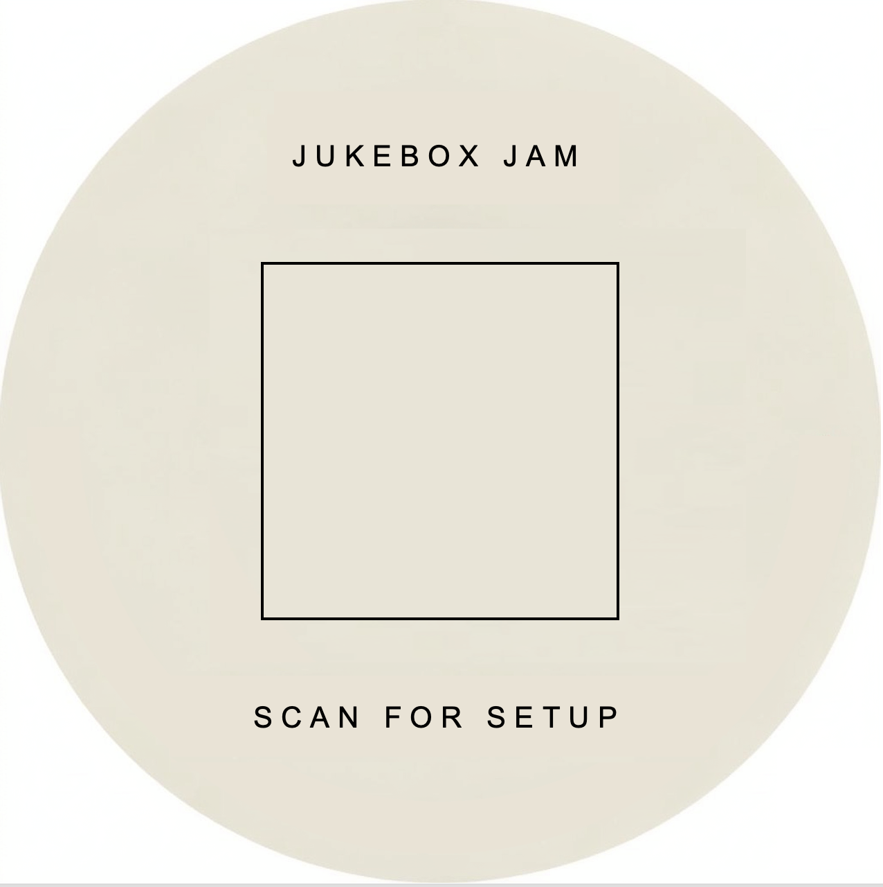
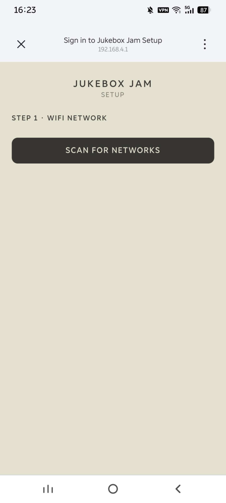
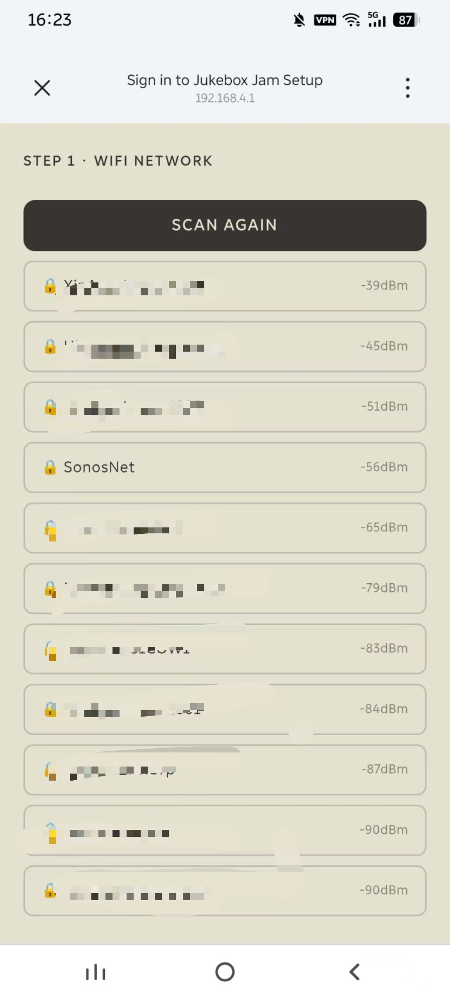
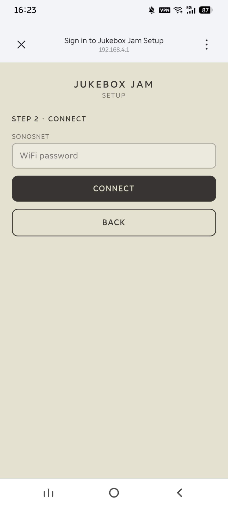
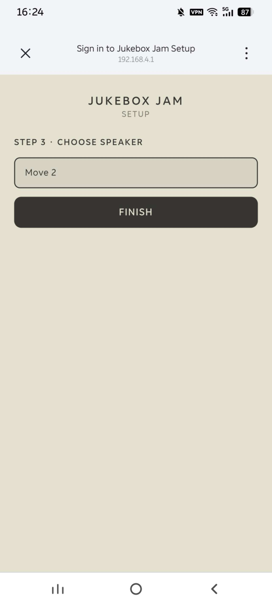
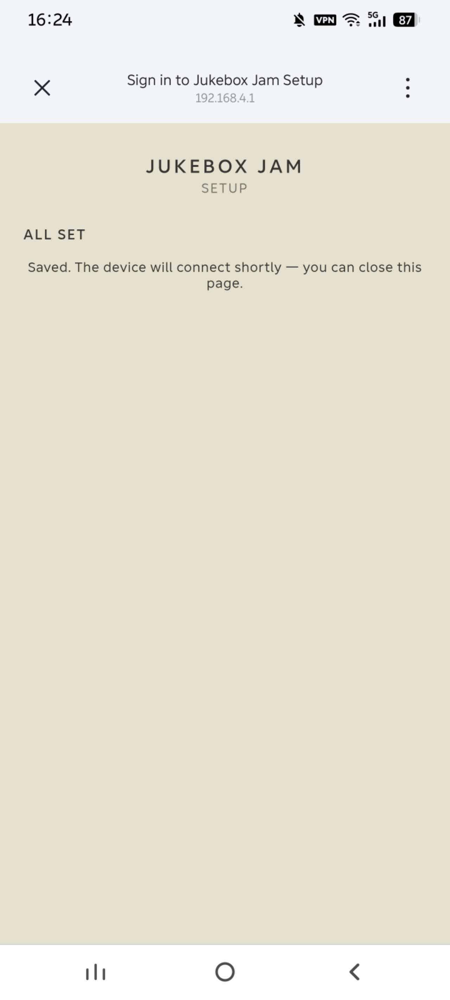
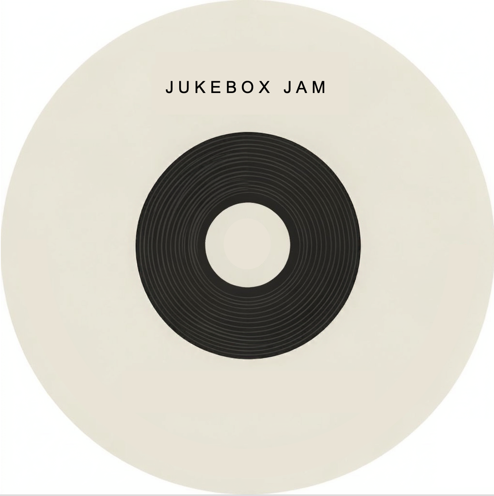
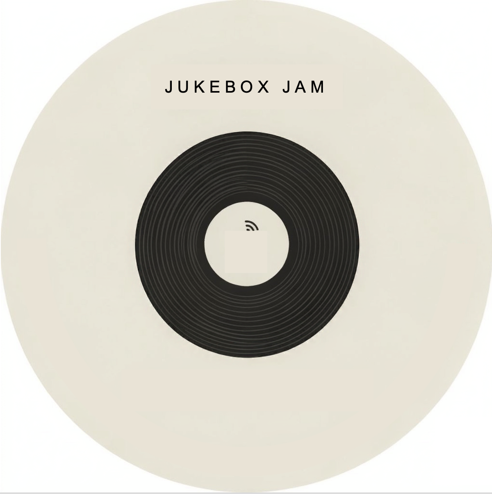
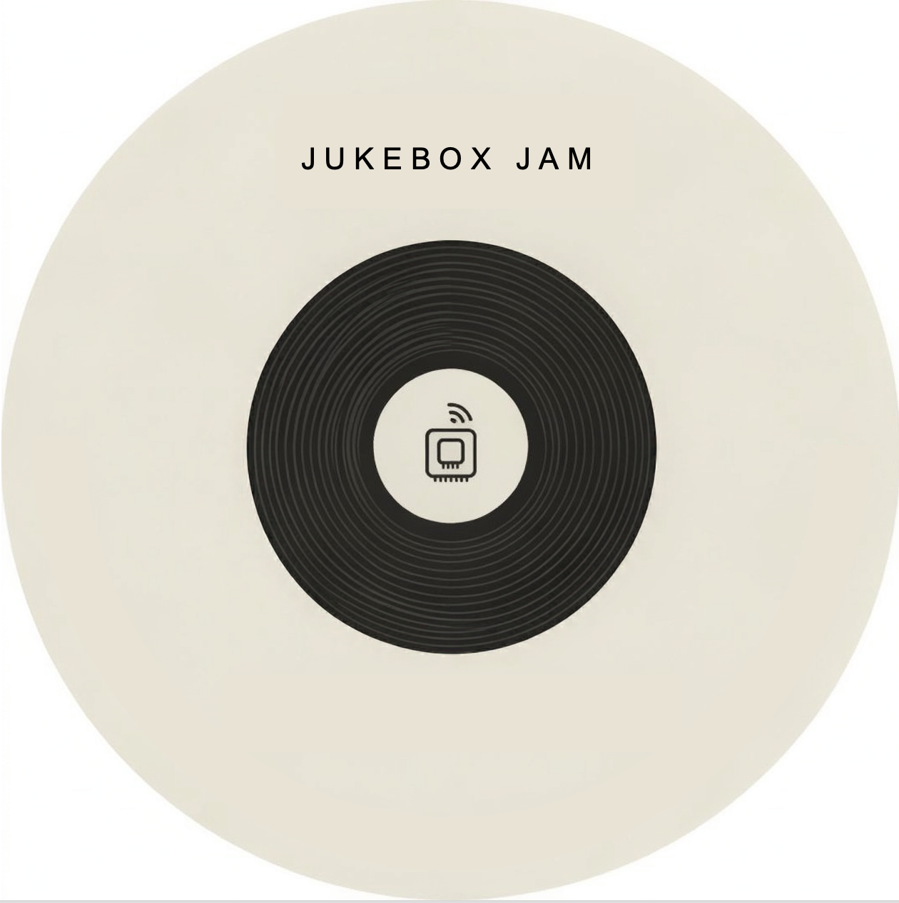
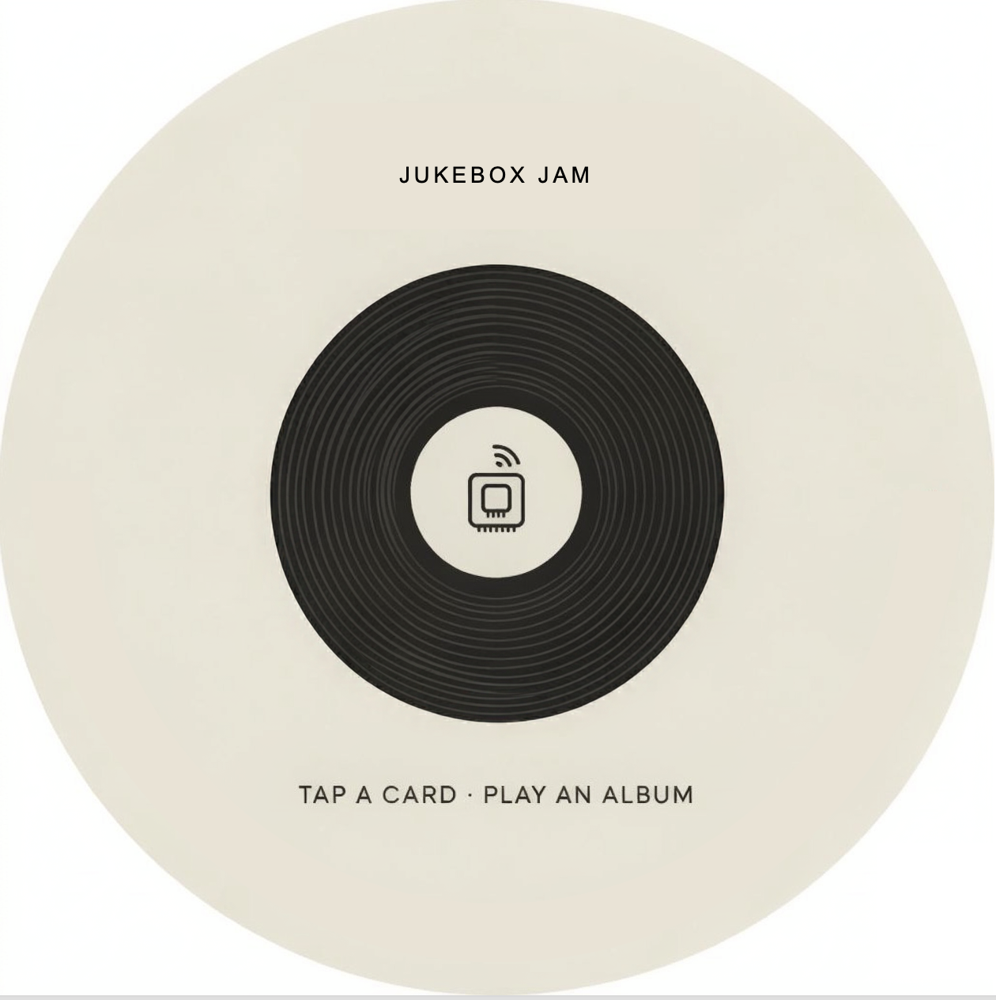

# ESP NFC Sonos

A standalone ESP32-S3 device with a round display: shows the current
Sonos/Spotify album art fullscreen, and plays a Spotify album/track/playlist
when an NFC tag is tapped against it.

This README has two parts:

- **[📖 User Guide](#-user-guide)** — setting the device up and using it
  day to day. No code involved.
- **[🛠 Developer Guide](#-developer-guide)** — hardware, architecture,
  protocols, build/flash instructions, and everything under the hood.

---

# 📖 User Guide

## First-time setup

A factory-fresh device (or one that's been reset) boots straight into a
**Setup** screen — the vinyl artwork with a live QR code in its box:



1. **Scan the QR code** with your phone's camera. It joins the device's
   own temporary WiFi network directly — no need to dig through your
   phone's WiFi settings first.
2. Your phone should automatically pop up a "Sign in to Jukebox Jam
   Setup" page. If it doesn't, open a browser and go to `192.168.4.1`.
3. Walk through the wizard:

| Step | Screen |
|---|---|
| **1 · Scan for your WiFi network** | <br> |
| **2 · Enter the password, Connect** |  |
| **3 · Pick your Sonos speaker** (the first one found is pre-selected) |  |
| **4 · Finish** |  |

Once you tap **Finish**, the device saves everything and restarts —
within a few seconds it'll be showing the Boot screen and connecting for
real. There's no cancel button on the wizard by design: the device has no
touchscreen or buttons, and there's nothing else useful it can do until
WiFi is configured.

## Everyday use

**Tap a tag** against the device to play that album/track/playlist on
your Sonos speaker. A good tap plays a short chime and the screen drops
to a loading animation, then the album art once it loads. Two beeps
means the tag was there but couldn't be read (or isn't a recognised
tag).

The screen always reflects what's actually going on:

| Screen | Meaning |
|---|---|
|  | **Boot** — no WiFi connection |
|  | **Wifi** — WiFi connected, still looking for your Sonos speaker |
|  | **WifiSpeaker** — speaker found, NFC reader still starting up |
|  | **Ready** — tap a card! |
| *(fullscreen album art)* | **Art** — something's playing |

Pausing or stopping whatever's playing switches straight back to
**Ready**, and resuming switches back to the album art — the screen
always tracks reality, not just whatever it decided at boot.

**Idle dimming:** if the screen sits on Ready for 30 seconds with nothing
happening, it dims gradually down to a low brightness floor over about
4 seconds — this is normal, not a fault. Tapping a tag or anything else
happening (playback starting, losing WiFi) brings it back to full
brightness instantly.

## Reconfiguring later

To change the WiFi network or the selected Sonos speaker on a device
that's already set up, **hold it vertical and upside-down** — rotated
180° from however it would naturally stand — for about 3 seconds. This
is a pose the device would never end up in by accident (it only ever
sits flat or the right way up in a stand), so it's safe as a deliberate
gesture even with no touchscreen or buttons to press.

The device will restart straight into the Setup screen above — just
walk through the wizard again.

## Troubleshooting

- **Nothing happens when I scan the QR code / I can't find the WiFi
  network.** Make sure you're close enough to the device, and that your
  phone's WiFi is actually on (the QR code only *joins* the network, your
  phone's radio still needs to be enabled). If the captive-portal page
  doesn't pop up automatically, open a browser and go to `192.168.4.1`
  manually.
- **The screen is dim.** That's the idle-dimming feature after 30s on the
  Ready screen (see above) — not a fault. Tap a card and it'll come back
  to full brightness.
- **Tapping a tag does nothing.** Make sure the tag actually touches the
  reader area and lift it fully off between taps (resting it on the
  reader without lifting can look like "nothing happened" for a second
  tap). Two beeps instead of silence means the tag was detected but
  couldn't be read — it may not have the right data written to it.
- **The device is stuck on the Boot screen.** It can't find your WiFi
  network — check the network is in range and hasn't changed its
  password. Use the "Reconfiguring later" gesture above to run the setup
  wizard again with new details.

---

# 🛠 Developer Guide

## Hardware

- **Board:** Waveshare ESP32-S3-Touch-LCD-1.85 (non-touch variant).
  ESP32-S3R8 (16MB flash, 8MB Octal PSRAM), ST77916 round QSPI LCD,
  TCA9554PWR I2C IO expander, PCM5101 I2S DAC, QMI8658 6-axis IMU,
  PCF85063 RTC (unused so far).
- **NFC module:** a cheap, unlabeled-beyond-silkscreen "HW-033" RC522-based
  UART bridge module. Its wire protocol is **not documented anywhere** —
  see [`docs/NFC_PROTOCOL.md`](docs/NFC_PROTOCOL.md) for everything learned
  about it the hard way. If you're sourcing a module fresh, a real PN532
  breakout (I2C/SPI) with known libraries would be far less effort; this
  project ended up reverse-engineering the HW-033's protocol instead of
  swapping hardware.
- **Speaker:** any Sonos speaker on the same network, with a linked Spotify
  account.

### Wiring

| ESP32 pin (Waveshare UART header) | NFC module pin |
|---|---|
| GND | GND |
| 3V3 *or* an external supply (see note) | VCC |
| GPIO43 (TXD) | RX |
| GPIO44 (RXD) | TX |

ESP32 TX goes to the module's RX, and ESP32 RX comes from the module's TX
(crossed over, as usual for UART), plus a common GND. Module VCC per its
own supply requirements (this specific module's listing recommends 5V; see
`docs/NFC_PROTOCOL.md` for the power/logic-level reasoning). Pin
assignments live in [`src/board_config.h`](src/board_config.h).

The display, I2C expander, I2S DAC, and IMU are all onboard the Waveshare
board — no extra wiring needed for those.

## Status

As of **V1.2**, confirmed working end-to-end on real hardware: the full
WiFi + Sonos setup wizard (including the DNS/HTTP captive portal and a
real phone joining and completing it), boot → WiFi/speaker discovery →
the full Setup/Boot/Wifi/WifiSpeaker/Ready/Art UI cycle, live
playback-state reacting (pause/resume, external track changes,
NFC-tap-triggered plays), NFC tag read, NFC-triggered Spotify playback,
idle screen dimming, and the IMU-based setup re-entry gesture.

| Feature | Status |
|---|---|
| WiFi + Sonos speaker setup wizard (captive portal) | Done — confirmed end-to-end on real hardware, including a real phone joining the AP and completing the wizard. See "Setup wizard internals" below |
| IMU-based setup re-entry gesture | Done — confirmed on real hardware. See "IMU setup re-entry" below |
| UI states (Setup/Boot/Wifi/WifiSpeaker/Ready/Art, live-reactive) | Done — confirmed on hardware, including external track changes, pause/resume, and NFC-tap-triggered plays |
| Sonos discovery, speaker selection | Done — via the setup wizard (NVS-persisted), not build-time config |
| Fullscreen album art + loading spinner (inside the vinyl's label hole) | Done — see "Fixed bugs of note" below for several real races this went through |
| NFC tag read (UID + NDEF text) | Done — real UID detection and NDEF parsing confirmed on hardware. Self-heals from a lost boot-time antenna-enable (see `docs/NFC_PROTOCOL.md`'s Gotchas) — confirm wiring/grounding first if taps stop registering despite otherwise-healthy comms |
| NFC → Spotify playback on tap | Done — confirmed end-to-end on hardware, still via a **temporary hardcoded test URI** (see below); needs a real NDEF-written tag to fully retire that override |
| Good-tap sound / bad-tap beep feedback | Done — confirmed on hardware; tap-sound volume has gone through several rounds of reduction and may still need another pass, and a distinct custom tone (rather than just a quieter version of the current clip) is wanted |
| Live playback-state reacting (pause/resume switches Ready ↔ Art automatically) | Done — confirmed on hardware |
| Idle screen dimming (Ready screen only) | Done — see "Idle dimming" in the User Guide |
| Boot-screen version label | Done |
| Album art download/scale speed | Was 10-50s, now ~2-3s typically — see `docs/NFC_PROTOCOL.md`'s note on the UART console conflict. Direct Spotify CDN links get resized to 300x300 before downloading (see `album_art.c`); art served through Sonos's `/getaa` proxy stays at 640x640 and is scaled locally — confirmed by direct testing that `/getaa` ignores every resize query param for Spotify content, so this isn't fixable from our side |
| Sonos playback reliability | Several real failure modes found and fixed (see "Sonos playback reliability" below) by probing the speaker directly during testing — some intermittent failures during this round of testing may be regional network interference rather than a firmware issue, needs retesting in a different network environment |

### Known temporary hack

`src/nfc_reader.c`'s `nfc_reader_poll()` has a **hardcoded UID → Spotify URI
override** for the one test tag used during development (a blank Mifare
Classic card, UID `82BA2006`) — the only tag on hand while building this.
Remove it once you have a tag actually written with NDEF text in the
`service:type:id` format (see below), and confirm the real NDEF read path
works against it.

## Tag format

Tags are written with an NDEF Text record whose payload is a bare
`"service:type:id"` string — same scheme as the ESP Sonos Controller
project, e.g.:

```
spotify:album:2dfTV7CktUEBkZCHiB7VQB
spotify:track:4uLU6hMCjMI75M1A2tKUQC
spotify:playlist:37i9dQZF1DXcBWIGoYBM5M
```

Only `spotify:` is supported — `sonos_controller.c`'s
`build_spotify_uri_meta()` rejects anything else. Currently only **Mifare
Classic 1K** tags (4-byte UID) are supported for reading; NTAG21x tags
(7-byte UID) would need a different read path (the sibling PN532 project
has one; this project doesn't yet — see Outstanding work below).

Writing tags is out of scope for this project — use the ESP Sonos
Controller project or any NFC Tools app for that; this project only reads.

## UI states & assets

The screen is one of six states, re-evaluated continuously (not just
decided once at boot) by `main.c`'s `nfc_loop_task` — see the User
Guide's "Everyday use" for what each one looks like:

| State | Shown when | Artwork |
|---|---|---|
| **Setup** | No WiFi credentials saved in NVS yet | Vinyl with a QR code in its label hole, `src/assets/setup.jpg` |
| **Boot** | No WiFi | Plain vinyl record + firmware version (`V` + `FIRMWARE_VERSION` from `app_config.h`), `src/assets/boot.jpg` |
| **Wifi** | WiFi connected, no Sonos speaker found | Vinyl with a WiFi icon, `src/assets/wifi.jpg` |
| **WifiSpeaker** | WiFi + speaker found, NFC reader not yet confirmed working | Vinyl with an NFC icon (no "tap a card" text), `src/assets/wifispeaker.jpg` |
| **Ready** | WiFi + speaker + NFC all confirmed, nothing actively playing (idle/paused/stopped) | Vinyl with an NFC icon + "TAP A CARD · PLAY AN ALBUM", `src/assets/ready.jpg` |
| **Art** | WiFi + speaker found, actively playing | Fullscreen Sonos/Spotify album art |

`main.c`'s `boot_task()` walks Boot → Wifi → WifiSpeaker in order as each
condition is actually met during boot (after the one-time Setup gate, if
it ran), holding each one on screen for at least `BOOT_STEP_MIN_DISPLAY_MS`
(`app_config.h`) — without that, a fast WiFi/Sonos connection could make
the live state machine's first evaluation find every condition already
true at once and jump straight to the final state, skipping the
intermediate screens entirely (this genuinely happened before this was
added).

Playback state is polled live from the speaker (AVTransport's
`GetTransportInfo` → `CurrentTransportState`), so pausing/stopping a track
switches back to **Ready** automatically, and resuming switches back to
**Art** — not just a one-time decision at boot. The NFC reader's health
(`nfc_reader_is_healthy()`) is also checked live, so Ready only ever
invites a tap when the reader is actually confirmed working.

While new art is downloading/decoding, the **Boot** vinyl is shown with a
small spinner inside its label hole (not a blank screen or stale art).

### Idle dimming

Only while continuously on **Ready** (nothing playing, nothing actionable
on screen): after `READY_DIM_IDLE_MS` with no state change, brightness
ramps linearly from 100% down to `READY_DIM_TARGET_PCT` over
`READY_DIM_RAMP_MS` (`app_config.h`). Any other state — a tap, playback
starting, losing WiFi/the speaker — snaps brightness back to 100%
immediately rather than ramping back up, so the screen is never still dim
right when something actually happened. Implemented in `main.c`'s
`nfc_loop_task`, driven by the existing PWM/LEDC backlight
(`display_set_brightness()` in `display.c`).

### Asset pipeline

Source artwork lives in `Assets/` (the original ~1260×1264 PNGs — not used
directly) and `src/assets/` (the processed files actually embedded in the
firmware):

- `boot.jpg` / `wifi.jpg` / `wifispeaker.jpg` / `ready.jpg` / `setup.jpg` —
  each source PNG cropped to a centered square, resized to 360×360, and
  saved as JPEG (quality 90). Decoded once at boot in `ui_assets.c` using
  the same TJpgDec-based decoder as `album_art.c`.
- `nfc_tap.wav` — converted from the provided `NfcTap.mp3` with macOS's
  built-in `afconvert`, since this project has no MP3 decoder and doesn't
  need one:

  ```bash
  afconvert -f WAVE -d LEI16@16000 -c 2 NfcTap.mp3 src/assets/nfc_tap.wav
  ```

  This matches `buzzer.c`'s I2S config exactly (16-bit, stereo, 16kHz), so
  it streams straight to the DAC with no resampling. `buzzer.c` walks the
  WAV's RIFF chunks to find the `data` chunk rather than assuming a fixed
  44-byte header (`afconvert`'s output pads it further).

All five images + the sound clip are embedded into the firmware as **plain
generated C byte arrays** (`src/assets/boot_jpg.c`, `wifi_jpg.c`,
`wifispeaker_jpg.c`, `ready_jpg.c`, `setup_jpg.c`, `nfc_tap_wav.c` +
matching `.h` files), run through `src/assets/generate.py`:

```bash
python3 src/assets/generate.py
```

This is deliberately *not* `idf_component_register`'s `EMBED_FILES` —
that mechanism generates mangled/doubled intermediate `.S`-file paths
under PlatformIO's ESP-IDF integration (it assumes `idf.py`'s native
directory layout), which fails the build outright. Plain C sources have
no such issue and are picked up by `src/CMakeLists.txt`'s normal `*.c`
glob like any other source file.

**To replace any of these assets:** crop the replacement to a centered
square and resize to 360×360 (matching the existing files in
`src/assets/`), overwrite the matching raw file there, run
`python3 src/assets/generate.py` to regenerate the C sources, then
rebuild. No other code changes needed unless the dimensions or audio
format change.

`Assets/Speaker.png` is an unused leftover from an earlier draft (a
"speaker found, no WiFi" state that turned out to be impossible, since
finding a speaker requires WiFi first) — safe to delete.

## Setup wizard internals

See the User Guide's "First-time setup" for the user-facing walkthrough
with screenshots. This section covers how it actually works.

A factory-fresh device (or one with no WiFi credentials saved in NVS yet)
boots straight into the **Setup** UI state: the vinyl artwork with a live
QR code rendered into its box (`UI_SETUP_QR_X`/`Y`/`SIZE` in
`ui_assets.h`, via LVGL's `lv_qrcode` widget). The QR payload
(`setup_portal_qr_data()`) is a `WIFI:T:nopass;S:<ssid>;;` string, which
phone camera apps recognise natively and use to join the AP directly —
no manual WiFi settings needed.

Once joined, the device's DNS server (`setup_portal.c`'s
`dns_server_task`) answers every query with its own IP, so a phone's OS
connectivity-check probe (`generate_204`, `hotspot-detect.html`,
`connecttest.txt`, ...) resolves there and the HTTP server's wildcard
catch-all route (`h_redirect`) sends it straight to the wizard — the same
mechanism as the "Sign in to this network" prompt on public WiFi.

The wizard itself is a small single-page app served directly by the
device (`setup_portal.c`), styled to match the device's own vinyl artwork
(`#E4E1D0` background / `#363531` ink — see `main.c`'s spinner colors)
with a system-font fallback plus letter-spacing approximating
Montserrat's look, since a phone on this isolated AP has no route to an
actual font CDN:

1. **Scan for WiFi networks** (`GET /api/scan`, via `wifi_manager_scan()`).
2. **Enter the password, Connect** (`POST /api/connect`) — the device
   test-connects (`wifi_manager_test_connect()`; the AP stays up
   throughout via `WIFI_MODE_APSTA`) before anything is saved, so a wrong
   password never gets persisted.
3. **Sonos speaker detection** (`GET /api/sonos/scan`, via
   `sonos_controller_discover()` + `sonos_controller_list_speakers()`)
   runs automatically once connected, with the first speaker found
   pre-selected — pick a different one if needed.
4. **Finish** (`POST /api/finish`) — persists WiFi credentials + the
   chosen speaker to NVS (`wifi_manager_save_credentials()`,
   `sonos_controller_select_speaker()`), then schedules a clean
   `esp_restart()` after a short delay (long enough for the HTTP response
   and the wizard's "All Set" step to actually reach the phone first).

No cancel button by design — this board has no touch/buttons, and
there's nothing useful to do without WiFi configured anyway.

**Why a reboot, not an in-place reconnect:** the first implementation
tried to gracefully drop setup-AP mode and reconnect within the same
running WiFi driver instance. On real hardware, the STA stayed silently
associated from the wizard's own test-connect (`h_connect`) the whole
time, since nothing had ever explicitly disconnected it — so the
"reconnect" call was a no-op: no new connect/disconnect event ever fired,
and the device sat on the Boot screen indefinitely with no further log
output. A clean `esp_restart()` after saving sidesteps that whole class of
WiFi-driver-state bug, and is what both the initial wizard and the IMU
re-entry gesture (below) use.

DNS-hijack + wildcard-route + HTTP-server tuning (`lru_purge_enable`,
larger worker stack for the Sonos-discovery handler, registering both GET
and HEAD on the catch-all route) are carried over from captive-portal
fixes already confirmed on real hardware in the sibling Grill & Groove
project (`/Users/ESP32MusicAndMeat/src/wifi_manager.c`) — see
`setup_portal.c`'s comments for specifics.

**Dev-workflow note:** `wifi_creds.h` is no longer used for normal
operation (NVS is the only source of truth), but if NVS has no saved
credentials yet and that file exists, its values seed NVS once — so this
project's own dev-flashing workflow doesn't need to run through the
wizard on every reflash. A real shipped device without that header just
goes straight to Setup.

### IMU setup re-entry

See the User Guide's "Reconfiguring later" for the user-facing gesture.
Confirmed working on real hardware: holding the device vertical, rotated
180° from its natural orientation, for `IMU_TRIGGER_HOLD_MS` restarts it
straight into the Setup wizard above, even though real credentials are
already saved.

The board's QMI8658 6-axis IMU is on the same I2C bus as the TCA9554
expander (no extra wiring) — not documented on Waveshare's own wiki page
for this board at all, only confirmed by fetching the manufacturer's own
QMI8658A datasheet directly, which also isn't linked from the wiki.
`imu.c` probes both possible I2C addresses (0x6A/0x6B — the SA0 strap
isn't documented for this specific board either; this board uses 0x6B)
and confirms the chip via its `WHO_AM_I` register before enabling the
accelerometer at ±2g.

The trigger pose itself was found empirically, not from a datasheet: real
device readings for "vertical, rotated 180°" came back approximately
`ax=-0.96g, ay=-0.07g, az=+0.09g`, which is what `main.c`'s
`imu_in_setup_trigger_pose()` checks against (`IMU_TRIGGER_AX_MAX`,
`IMU_TRIGGER_LATERAL_MAX` in `app_config.h`) — naturally exclusive of flat
(gravity lands on Z) or correctly-oriented vertical (`ax` reads
positive, not negative). `imu_trigger_task` polls every
`IMU_POLL_INTERVAL_MS`, requires a continuous `IMU_TRIGGER_HOLD_MS` hold
(logging only on entering/leaving the pose, not every poll), then calls
`wifi_manager_request_setup_on_next_boot()` (an NVS flag) followed by
`esp_restart()`. `boot_task` checks and clears that flag right after the
normal connect attempt, forcing the same Setup path a factory-fresh
device takes if it's set.

## Getting started (building this project)

1. **(Optional, for this project's own dev workflow) Pre-seed WiFi
   credentials.** Copy/create `src/wifi_creds.h` (gitignored — never
   commit real credentials) to skip the wizard on a fresh flash — see
   "Setup wizard internals" above for why this is optional, not required:

   ```c
   #pragma once
   #define WIFI_SSID     "YourNetwork"
   #define WIFI_PASSWORD "YourPassword"
   ```

2. **Build & flash** (PlatformIO, ESP-IDF framework):

   ```bash
   pio run -t upload
   pio device monitor
   ```

   If you change `sdkconfig.defaults`, delete the generated
   `sdkconfig.album_nfc` first — PlatformIO/ESP-IDF won't re-apply defaults
   over an existing generated config:

   ```bash
   rm sdkconfig.album_nfc
   pio run -t upload
   ```

3. **Tap a tag.** A good tap plays the NFC-tap chime and starts playback
   (screen drops to the loading vinyl, then the album art once it's
   decoded). Two buzzer beeps = tag present but unreadable/not a
   recognised URI.

## Configuration reference

All tunables live in [`src/app_config.h`](src/app_config.h):

| Setting | Meaning |
|---|---|
| `DISPLAY_WIDTH`/`HEIGHT` | Panel resolution (360x360, round) |
| `WIFI_CONNECT_TIMEOUT_MS` | How long to wait for WiFi before showing "No WiFi" |
| `SONOS_DISCOVERY_TIMEOUT_MS` | SSDP discovery window |
| `SONOS_POLL_INTERVAL_MS` | How often to poll the speaker for current track |
| `SPOTIFY_DEFAULT_SID`/`SN` | Cold-start Spotify service params (learned from any currently-playing Spotify track if available) |
| `ART_MAX_DOWNLOAD_BYTES` | Download buffer cap (768KB — headroom over real covers) |
| `NFC_UART_BAUD` | 115200, confirmed from the module's manufacturer listing |
| `NFC_POLL_INTERVAL_MS` | How often the NFC loop checks for a tag, and re-evaluates the UI state/dimming — 100ms; idle sampling rate only, independent of the one-off per-tag SELECT/AUTH/READ cost and of `ANTENNA_REASSERT_INTERVAL_MS` |
| `BEEP_FREQ_HZ`/`DURATION_MS`/`GAP_MS` | Synthesized bad-tap beep tone (good tap uses the `nfc_tap.wav` sound clip instead) |
| `TAP_LOADING_TIMEOUT_MS` | Max time the loading screen rides out a tap-triggered play before falling back if nothing ever actually started |
| `CMD_SETTLE_GRACE_MS` | How long after a tap-triggered play finishes setup to keep ignoring a stale "not playing" transport reading — see "Sonos playback reliability" |
| `READY_DIM_IDLE_MS`/`RAMP_MS`/`TARGET_PCT` | Idle screen dimming on Ready — see "Idle dimming" above |
| `WIFI_AP_SSID`/`CHANNEL`/`MAX_CONN`/`IP` | The setup wizard's temporary AP — see "Setup wizard internals" |
| `IMU_TRIGGER_AX_MAX`/`LATERAL_MAX`/`HOLD_MS`, `IMU_POLL_INTERVAL_MS` | The setup re-entry gesture — see "IMU setup re-entry" |

Hardware pins: [`src/board_config.h`](src/board_config.h).

## Architecture

| File | Responsibility |
|---|---|
| `main.c` | Boot sequence (including the one-time Setup gate), the continuous Setup/Boot/Wifi/WifiSpeaker/Ready/Art UI state machine, the main NFC-tap loop, the IMU setup re-entry gesture |
| `wifi_manager.c` | NVS-held STA credentials/connect, plus the setup AP (`WIFI_MODE_APSTA`), scanning and test-connect the wizard needs, the force-setup-on-next-boot flag |
| `setup_portal.c` | The setup wizard itself: DNS captive-portal hijack, HTTP server, wizard HTML/JS, WiFi scan/connect + Sonos speaker detection endpoints |
| `tca9554.c` | I2C IO expander — drives the LCD's real reset line |
| `imu.c` | QMI8658 accelerometer, shared I2C bus — for the setup re-entry gesture (see "IMU setup re-entry") |
| `display.c` | ST77916 QSPI panel init via `esp_lvgl_port` |
| `ui_assets.c` | Decodes the embedded Setup/Boot/Wifi/WifiSpeaker/Ready vinyl JPEGs once at boot (see "UI states & assets") |
| `album_art.c` | HTTP download, JPEG decode (TJpgDec), nearest-neighbor scale to the panel |
| `nfc_reader.c` | HW-033 UART protocol, tag detection, NDEF text read |
| `sonos_controller.c` | SSDP discovery, SOAP control, direct (server-free) Spotify playback, track + live transport-state polling, speaker list/selection for the setup wizard |
| `buzzer.c` | I2S playback through the onboard DAC — the embedded NFC-tap sound clip for good taps, a synthesized tone for bad taps |
| `globals.c` | Shared state: network mutex, inter-request cooldown timing |

## Sonos playback reliability

`play_spotify_direct()` in `sonos_controller.c` (the sequence a good NFC
tap triggers: clear queue → add the Spotify URI → point the transport at
the queue → seek to track 1 → play) went through several rounds of
hardening after probing the speaker's own UPnP API directly during
testing — not just reasoning from our own logs — surfaced real failure
modes:

- **No settle delay after `AddURIToQueue`.** For a container URI
  (album/playlist), Sonos accepting the request doesn't mean it's
  resolved the container into actual tracks yet — that means Sonos
  fetching the container's contents from Spotify's catalog over the
  internet, which doesn't happen synchronously within the call. Seeking
  and playing immediately, before that settles, reliably got the speaker
  stuck in `TRANSITIONING` forever — confirmed by querying
  `GetTransportInfo` directly against the speaker, independent of this
  firmware entirely — needing a full speaker power-cycle to clear. Fixed
  with an 800ms delay before proceeding.
- **`AddURIToQueue` timing out while Sonos is already streaming
  something else.** Queue-mutating calls can be slow to answer when the
  speaker's mid-stream on whatever's currently playing. Fixed by raising
  the SOAP HTTP timeout (3s → 6s) and retrying that one call once.
- **`AddURIToQueue` reporting success (`200`) while leaving the queue
  genuinely empty.** Confirmed directly via `GetMediaInfo`'s `NrTracks`
  field reading `0` immediately after a "successful" add — which then
  made the following `Seek`/`Play` fail outright with SOAP 500s. Fixed by
  actually checking `NrTracks` after the settle delay, with one retry of
  the add, rather than trusting the HTTP status alone.
- **Album art prefetch starving the queue-verification retry.**
  `album_art.c`'s download holds the shared network mutex (`g_network_mutex`)
  for its whole multi-second transfer. If that prefetch landed while
  `cmd_task` was mid-sequence verifying the queue actually populated, its
  SOAP retry got starved long enough to misreport a tap that had actually
  succeeded as "giving up." Fixed by exposing `sonos_is_cmd_pending()`
  (`sonos_controller.c`) and having `main.c`'s `nfc_loop_task` defer firing
  `album_art_request()` while a tap-triggered play is still being set up —
  it fires on the next iteration once no longer pending, nothing is lost.
- **Stale `transport_state` reads right after setup finishes.**
  `poll_task` only refreshes `transport_state`/`is_playing` every
  `SONOS_POLL_INTERVAL_MS` on its own schedule. The instant
  `sonos_is_cmd_pending()` clears, the last-known reading can still be the
  transient `STOPPED` a queue rebuild reports *during* setup, not yet
  whatever actually follows — which was enough to cancel the tap's loading
  screen and briefly show bare Ready with no spinner. Fixed with a
  `CMD_SETTLE_GRACE_MS` window after `cmd_pending` clears (`main.c`),
  during which a "not playing" reading isn't trusted as genuinely settled.

Some playback failures during this project's testing may be regional
network interference between the Sonos speaker and Spotify's servers
rather than anything in this firmware — worth retesting in a different
network environment before chasing further "intermittent" failures as
code bugs.

## Fixed bugs of note

A few non-obvious races worth knowing about if they ever resurface:

- **Black screen the first time Art mode was ever reached.**
  `album_art.c`'s `s_art_dsc.data` pointer was only updated inside
  `album_art_update()`, which only runs while the UI is actually showing
  Art. `art_task` only waits up to `ART_CONSUMED_TIMEOUT_MS` for that to
  happen before moving on; if a track was queued/decoded while paused and
  that timeout elapsed before Art mode was ever entered, the decoded image
  was silently discarded and the pointer stayed stuck at whatever the
  buffer held *before* that decode — the pristine all-zero buffer on a
  fresh boot. Fixed by updating `s_art_dsc.data` synchronously inside
  `art_task` the instant a decode lands, not deferred to consumption.
- **Spinner animation freezing mid-tap.** `album_art.c`'s `art_task` runs
  pinned to core 1 at priority 10 for its JPEG decode/scale step (CPU-bound,
  not I/O-wait). The LVGL port's task defaults to no core affinity, so it
  could land on core 1 too and get preempted for however long that decode
  took. Fixed by pinning the LVGL port task to core 0 in `display.c`.
- **Boot-time flash of stale/corrupted screen content.** The backlight was
  turned on right after `display_init()`, before `ui_assets_init()`
  (JPEG-decoding the images) and `ui_screen_create()` had actually loaded
  the Boot image — showing whatever was left in the panel's own GRAM from
  before this boot (panel memory isn't cleared by a soft reset) for that
  whole window. Fixed by moving `display_set_backlight(true)` to after the
  Boot screen is actually created, in `main.c`'s `boot_task()`.
- **NFC double-taps at the faster poll interval.** The UID de-dupe latch
  cleared on the very first missed `REQUEST` reply — rare enough to not
  matter at the old 300ms poll interval, but common enough at 100ms to
  double-fire a play for a card that never actually left the reader. Fixed
  with a 3-consecutive-miss debounce before clearing the latch (see
  `docs/NFC_PROTOCOL.md`'s Gotchas).
- **WiFi silently never reconnecting after the setup wizard.** See "Why a
  reboot, not an in-place reconnect" under "Setup wizard internals" above.

## Dev troubleshooting

- **Stale sdkconfig.** If `sdkconfig.defaults` changes don't seem to take
  effect, delete `sdkconfig.album_nfc` and rebuild — this is a recurring
  PlatformIO/ESP-IDF gotcha, not a bug in your change.
- **NFC module silent.** See `docs/NFC_PROTOCOL.md`'s "Dead ends" section
  before re-deriving any of: baud rate, wiring, or protocol framing — all
  were exhaustively tried and ruled out before finding the real protocol
  and the GPIO43/44 console conflict.
- **Upload is slow/fragile.** `platformio.ini` currently pins
  `upload_speed = 9600` — this was dropped from a higher rate after
  repeated partial-upload failures pointed at a marginal signal/power path
  during flashing, not a timeout. Worth revisiting if you get a more
  reliable USB setup.
- **`Source '....S' not found` during build, mentioning a jpg/wav file.**
  That's `idf_component_register`'s `EMBED_FILES` breaking under
  PlatformIO's ESP-IDF integration — don't use it for new assets here (see
  "Asset pipeline" above). Use `src/assets/generate.py` instead.
- **Compile error about a missing `_xxx_data`/`_xxx_len` symbol.** If you
  add a new asset or rename one, update both `src/assets/generate.py`'s
  `ASSETS` list and the `#include "assets/<name>.h"` + call site in
  `ui_assets.c` or `buzzer.c`.
- **`431 Request Header Fields Too Large` on the setup portal.**
  `esp_http_server`'s default 512-byte header budget is too tight for a
  real phone browser's full set of request headers — bumped via
  `CONFIG_HTTPD_MAX_REQ_HDR_LEN`/`CONFIG_HTTPD_MAX_URI_LEN` in
  `sdkconfig.defaults` (remember the stale-sdkconfig gotcha above if you
  change these further).
- **Stack overflow in a task that only does `ESP_LOGI` with `%f`.**
  Confirmed on real hardware for `imu`'s calibration task: printf-family
  float formatting pulls in a surprisingly stack-heavy float-to-string
  path (a well-known ESP-IDF/newlib gotcha) — size task stacks with real
  headroom (4096 bytes minimum) for anything logging floats, not just
  what the log line itself looks like it needs.

## Outstanding work

- The wizard page approximates Montserrat with a system-font fallback +
  letter-spacing rather than the real font, since a phone on the
  isolated setup AP has no route to a font CDN — embedding an actual
  Montserrat subset (served from the same HTTP server, same embedding
  pipeline as the images) would get pixel-perfect fidelity if wanted.
- Tap-sound volume may still need further reduction, and a distinct
  custom tone (not just a quieter version of the current clip) is
  wanted — see `src/assets/generate.py`'s `TAP_SOUND_TARGET_PEAK`.
- Retire the hardcoded test-tag override in `nfc_reader.c` once a real
  NDEF-written tag is available.
- NTAG21x (7-byte UID) tag support, if needed — currently Mifare Classic
  only.
- Spotify `track`/`playlist` URI types are implemented but only `album` has
  been exercised end-to-end so far.
- Delete `Assets/Speaker.png` (confirmed unused).
- Retest Sonos playback reliability outside of networks that may
  interfere with Sonos/Spotify traffic (see "Sonos playback reliability"
  above) before treating any further intermittent failures as firmware
  bugs.
- Minor: a card wobbling on removal right after a good tap can trigger a
  second, confusing "bad tap" beep from a transient `anticoll` read
  failure — not a comms bug, just a possible debounce worth adding in
  `nfc_reader.c`/`main.c` if it's annoying in practice.
